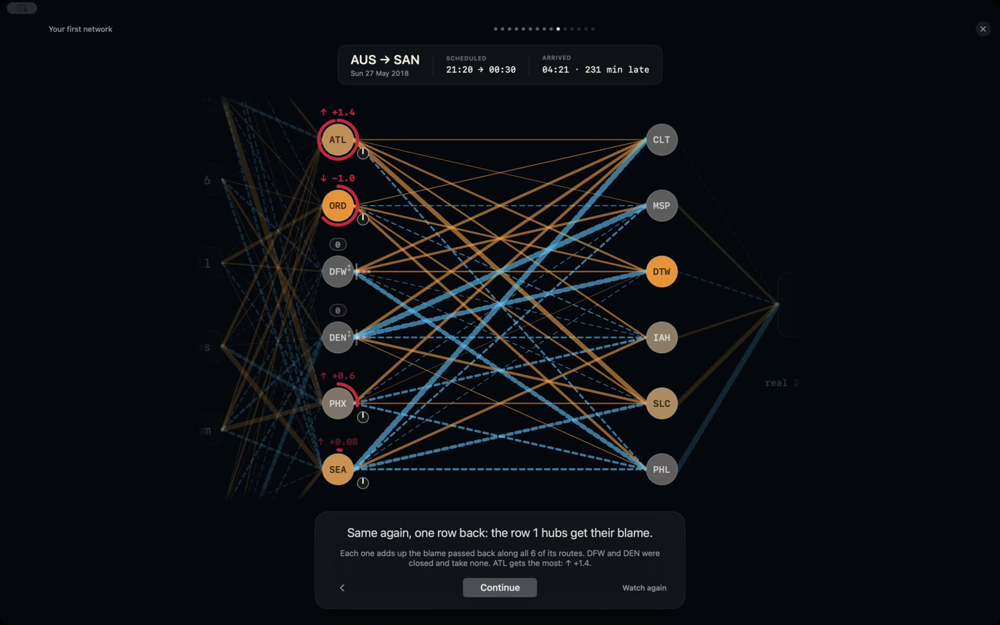
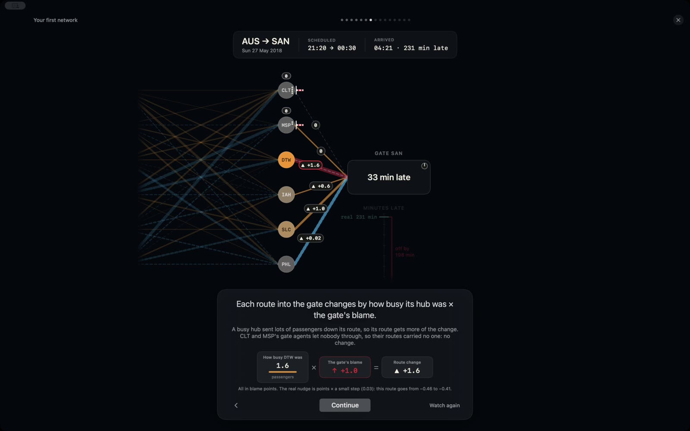
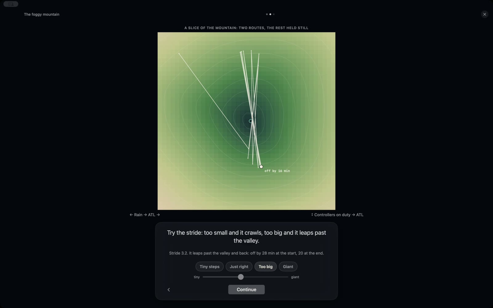
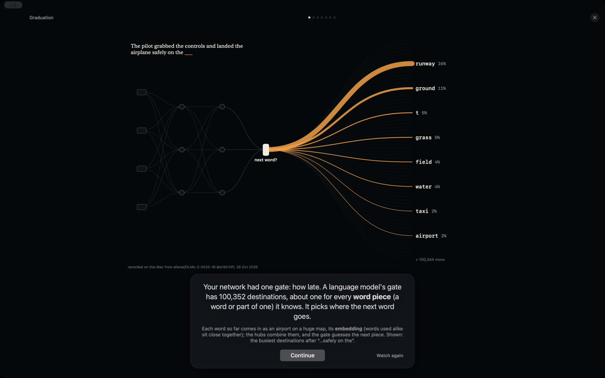

# NeuroScope AI

**Build a neural network out of an airline. Watch it learn. Then open up a real AI on your Mac.**

NeuroScope is a free macOS app that teaches how neural networks actually work, with no algebra. You build a tiny
network as an airline map, watch it guess how late a flight will be, and see every step of how it learns from
its mistakes. Then you graduate to a real, fully open language model ([OLMo 2 1B](https://allenai.org/olmo) from
Ai2), running entirely on your own Mac, and look inside it while it writes.

Website: [neuroscopeai.org](https://neuroscopeai.org)



## The idea

A neural network is a delay predictor run by an airline:

| Airline | Neural network |
|---|---|
| The dispatcher's **clipboard** (rain, wind, staff on duty, a holiday…) | the **inputs** |
| **Layover hubs** where facts meet | **hidden units** (neurons) |
| How many passengers a **route** carries | a **weight** |
| A hub's **gate agent**, who lets passengers through or holds them | the **activation function** (ReLU) |
| The destination **gate** and its guess: "33 min late" | the **output** |
| How far off the guess was | the **loss** |
| Walking the **blame** back from the gate, route by route | **backpropagation** |
| A blindfolded hiker feeling for downhill on a foggy mountain | **gradient descent** |

Every number on screen is computed live by a real network training on a real (synthetic) logbook of 120,000
flights. Nothing is a canned animation: when a route thickens, it is because that weight changed by that much.

## What's inside

### The airline course: build your own network

| | Lesson | What you learn |
|---|---|---|
| 0 | **Your first network** | One flight, one wrong guess, and the whole learning step shown move by move: how busy × blame = route change |
| 1 | **The rulebook** | Write the rules by hand, and find the 29-mph flight where rules run out |
| 2 | **The clipboard** | Inputs, and why every fact is put on the same scale first |
| 3 | **Direct routes** | The simplest network, and why it can't see "rain AND wind" |
| 4 | **Layover hubs** | Hidden layers: add hubs, train, and watch one hub start lighting up on stormy days |
| 5 | **The foggy mountain** | Gradient descent and step size: crawl, settle, zig-zag, or tumble off the map |
| 6 | **Name your hubs** | What each hub learned on its own, tested three ways before it earns a name |
| 7 | **Exam day** | Memorising vs. understanding: a sealed exam the network has never seen |
| 8 | **Close a route** | Switch off one part and see what breaks |
| 9 | **Graduation** | The same ideas at 1.5 billion routes: how OLMo 2 was pretrained, taught to answer, and checked |

After lesson 4 the **Builder** opens: the same map with no rails, for your own experiments.

<p>
  
  
</p>

### Inside a real AI: OLMo 2 1B, live

The app runs OLMo 2 1B Instruct locally (Rust + [candle](https://github.com/huggingface/candle) on Metal) and
shows all 16 × 8,192 MLP neurons, the "desks" on each "floor" of the building, firing word by word. Six short
lessons walk from "Meet the model" to finding an idea inside it and erasing it, then comparing the answers
before and after. Explore mode opens every control: your own prompts, neuron and head edits, replay and compare.



Why OLMo? It is **fully open**: not just the weights, but the training data, the code and the intermediate
checkpoints. That lets the Graduation lesson show real snapshots of the same model from before training to
finished, and point at similar text in its actual training data.

## Install and run

Requirements: a Mac with Apple silicon, macOS 15 or later, Xcode, and a [Rust](https://rustup.rs) toolchain.

```sh
git clone https://github.com/dmnurieli/neuroscopeai.git
cd neuroscopeai
scripts/build.sh --run
```

The airline course needs nothing else. The first time you open "Inside a real AI" or Graduation's live page,
the app downloads OLMo 2 1B Instruct (about 3 GB, a pinned revision) from Hugging Face into
`~/Library/Application Support/NeuroScope/models/`.

## How it's built

```
SwiftUI + Metal app (app/)          the lessons, the airline map, the 3D neuron field
   ├── AirlineKit (pure Swift)      the teaching network + seeded flight logbook, unit-tested
   └── C ABI  engine/include/neuroscope.h
         Rust engine (engine/)      OLMo 2 on candle/Metal: capture activations, edit them mid-pass
```

- The airline network is a small ReLU network with Huber loss, trained in pure Swift. The flight logbook is
  generated from a fixed seed, so every Mac sees the same 120,000 flights. Its delays come from combinations
  (a storm is rain AND wind), which is exactly what a network with hidden layers can learn and a straight
  line can't.
- The OLMo 2 engine is checked against Hugging Face transformers (`engine/tests/reference_olmo.rs`).
- The Graduation lesson's model outputs are recordings made with the app's own engine from Ai2's published
  training stages (`scripts/stages/`), so the app ships text, not nine model checkpoints.

Developer notes, build details and the rules that keep the lessons honest: [docs/DEVELOPING.md](docs/DEVELOPING.md).
The lesson-by-lesson spec: [docs/airline-course.md](docs/airline-course.md).

## Contributing

Contributions are welcome, especially from people who teach. Good places to start:

- **A better explanation.** If a lesson page lost you, that's a bug. Open an issue with the page and what
  confused you.
- **A new lesson or experiment**, in the airline course or inside OLMo.
- **Engine work**: more open models, faster capture, new kinds of edits.

Please read [docs/DEVELOPING.md](docs/DEVELOPING.md) first. One rule matters above the others: every number a
lesson states is computed, never typed.

## Credits

- [OLMo 2](https://allenai.org/olmo) by Ai2 (Apache 2.0): the model, its training stages and its open data.
- [candle](https://github.com/huggingface/candle) and [tokenizers](https://github.com/huggingface/tokenizers)
  by Hugging Face.
- [infini-gram](https://infini-gram.io) for counting phrases in OLMo's training data.

## License

[Apache License 2.0](LICENSE). Model weights are downloaded from Hugging Face under their own license and are
not part of this repository.
