<p align="center">
  
</p>

<p align="center">
  <a href="https://neuroscopeai.org"></a>
  
  
  <a href="https://allenai.org/olmo"></a>
  <a href="LICENSE"></a>
  
</p>

**NeuroScope AI is a free Mac app that teaches how neural networks actually work, by letting you build one out of an
airline.** Your network guesses how late a flight will be, gets it wrong, and you watch every step of how it learns
from the mistake, down to how much each route changed and why. Then you graduate to a real, fully open language
model ([OLMo 2 1B](https://allenai.org/olmo)), running on your own Mac, and look inside it while it writes.

No algebra. No canned animations: every number on screen comes from a real network training live.

The airline course is where it begins, not where it ends: NeuroScope AI is growing into an open school for AI, from
your first network to vision, speech and language models you train yourself. See [Upcoming additions](#upcoming-additions).

<p align="center">
  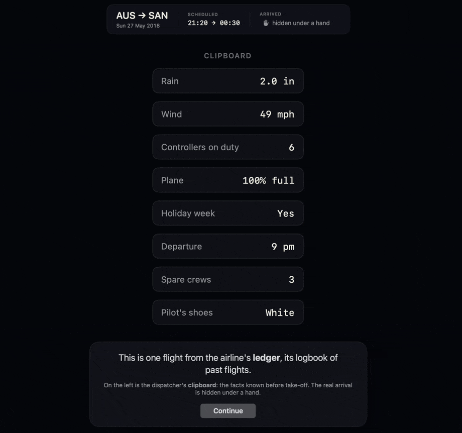
</p>

**[Install](#install-and-run)** · **[The route](#the-route)** · **[Inside a real AI](#inside-a-real-ai)** ·
**[Upcoming additions](#upcoming-additions)** · **[Contributing](#contributing)**

## The idea

A neural network is a delay predictor run by an airline. Every term in machine learning has a seat on this board:

<p align="center">
  
</p>

<details>
<summary>The same board as plain text</summary>

| In the airline | In a neural network | Lesson |
|---|---|---|
| The dispatcher's **clipboard** (rain, wind, staff on duty, a holiday…) | the **inputs** | 2 |
| How many passengers a **route** carries | a **weight** | 0 |
| A **layover hub** where facts meet | a **neuron** (hidden unit) | 4 |
| A hub's **gate agent**, who lets passengers through or holds them | the **activation function** (ReLU) | 0 |
| The destination **gate** and its guess: "33 min late" | the **output** | 0 |
| How many **minutes off** the guess was | the **loss** | 0 |
| Walking the **blame** back from the gate, route by route | **backpropagation** | 0 |
| A blindfolded hiker feeling for downhill on a **foggy mountain** | **gradient descent** | 5 |
| More **rows of hubs** | **deep** learning | 4 |
| **Naming a hub** from what wakes it up | **interpretability** | 6 |
| A student who **crams** the homework and fails the exam | **overfitting** | 7 |
| **Closing a route** to see what breaks | **ablation** | 8 |
| **Word airports** on a giant map | **embeddings** | 9 |

</details>

## Watch it learn

The first lesson takes one flight, one wrong guess, and shows the whole learning step move by move. Each route
changes by **how busy its hub was × the blame that reached it**, and the blame walks backward, row by row.

<table>
  <tr>
    <td width="50%">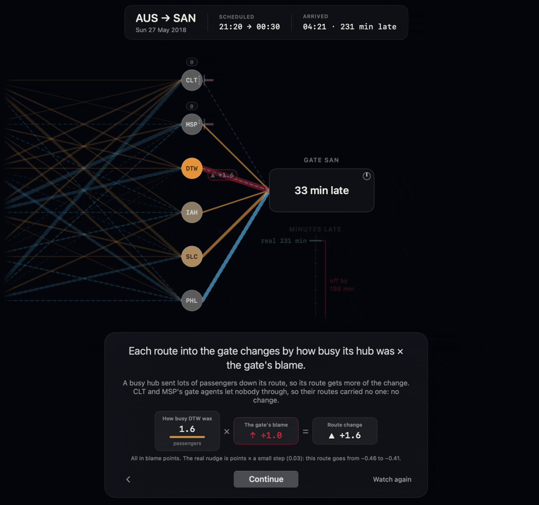</td>
    <td width="50%">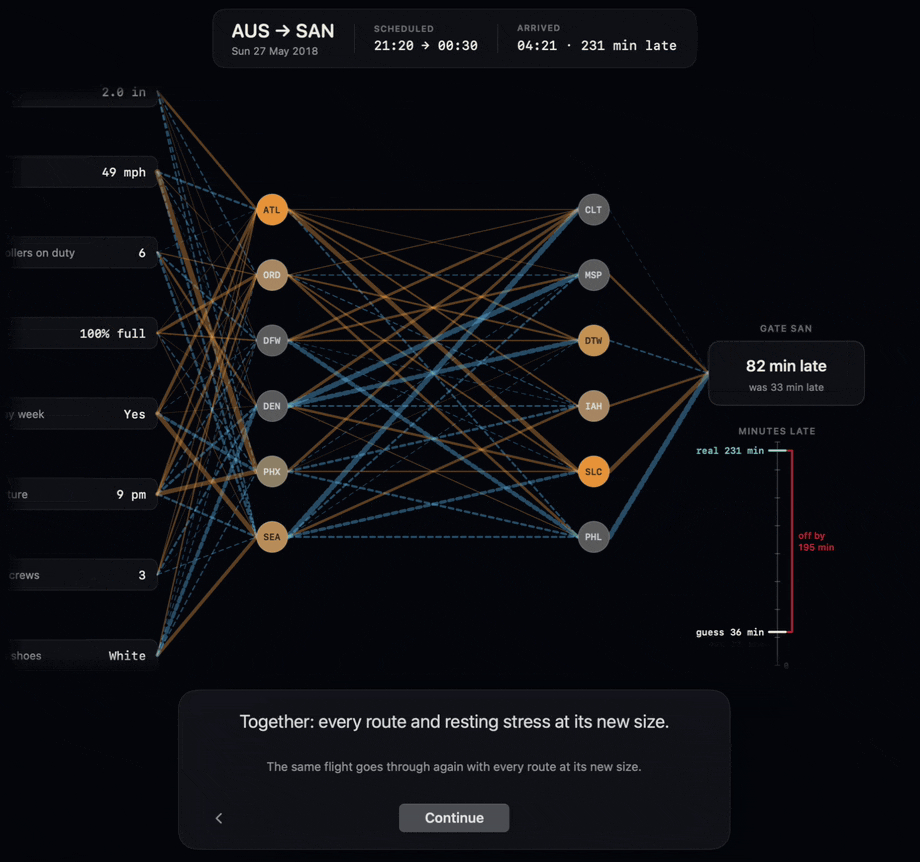</td>
  </tr>
  <tr>
    <td><b>Blame walks backward.</b> Backpropagation, one route at a time, with the real numbers.</td>
    <td><b>Then it practises</b> on 50,000 flights, and guesses one it has never seen: 86 minutes late, really 84.</td>
  </tr>
</table>

Add **layover hubs** and something nobody programmed happens: one hub starts lighting up on stormy days. The
logbook's delays come from *combinations* (a storm is rain AND wind), and only a network with hubs can see them.

<table>
  <tr>
    <td width="50%">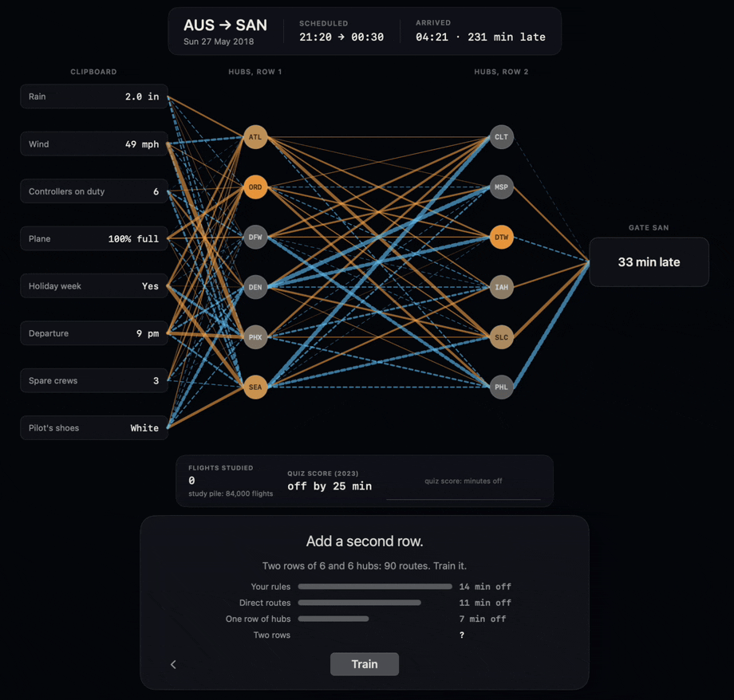</td>
    <td width="50%">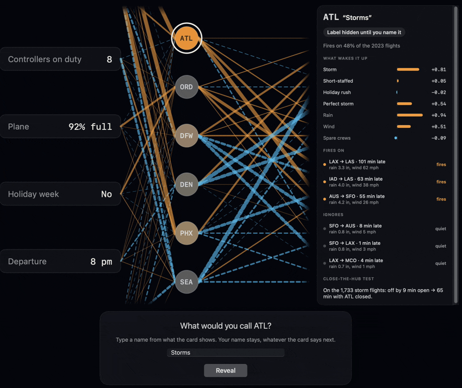</td>
  </tr>
  <tr>
    <td><b>Deep learning</b> just means more rows of hubs.</td>
    <td><b>Name your hubs.</b> Each one is tested three ways before it earns a name.</td>
  </tr>
  <tr>
    <td>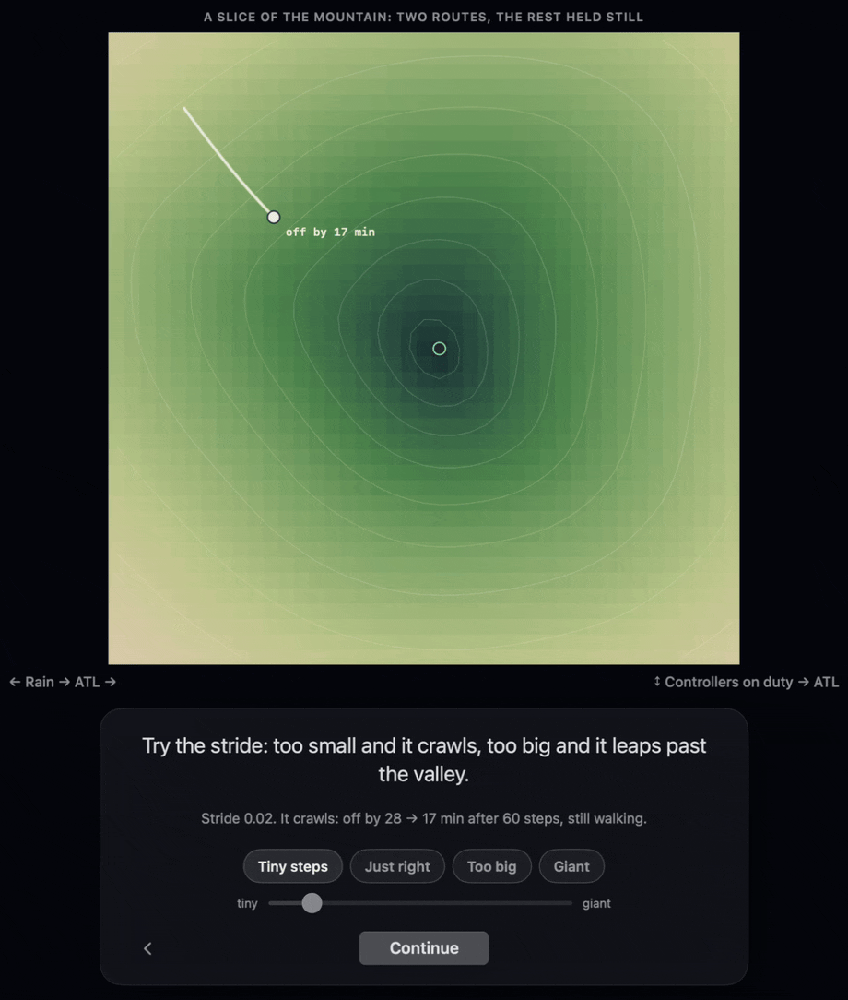</td>
    <td>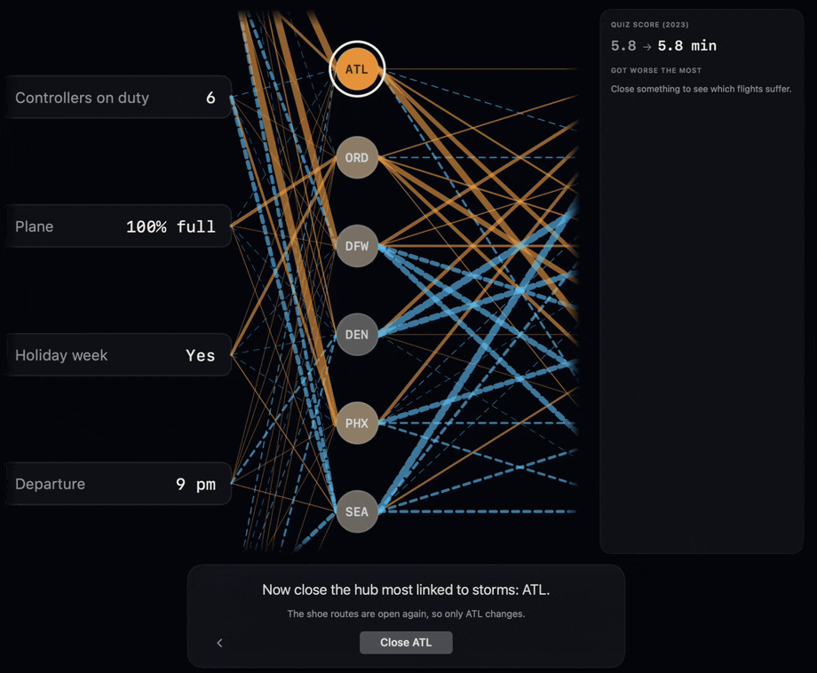</td>
  </tr>
  <tr>
    <td><b>The foggy mountain.</b> Too small a step crawls; too big leaps past the valley, or tumbles off the map.</td>
    <td><b>Close a route.</b> Switch off the storm hub and watch stormy flights fall apart.</td>
  </tr>
</table>

## The route

<p align="center">
  
</p>

| | Lesson | What you learn |
|---|---|---|
| 0 | **Your first network** | One flight, one wrong guess, and the whole learning step shown move by move |
| 1 | **The rulebook** | Write the rules by hand, and find the 29-mph flight where your rules run out |
| 2 | **The clipboard** | Inputs, and why every fact is put on the same scale first |
| 3 | **Direct routes** | The simplest network, and why it can't see "rain AND wind" |
| 4 | **Layover hubs** | Hidden layers; one hub starts lighting up on stormy days |
| 5 | **The foggy mountain** | Gradient descent and step size |
| 6 | **Name your hubs** | What each hub learned on its own, tested before it earns a name |
| 7 | **Exam day** | Memorising vs. understanding, on a sealed exam the network has never seen |
| 8 | **Close a route** | Switch off one part and see what breaks |
| 9 | **Graduation** | The same ideas at 1.5 billion routes: how OLMo 2 was pretrained, taught to answer, and checked |

After lesson 4 the **Builder** opens: the same map with no rails, for your own experiments.

## Inside a real AI

Graduation hands the same ideas to a real language model. Your network had one gate (how late?); a language model's
gate has **100,352** destinations, one per word piece. You watch real snapshots of OLMo 2 from before training to
finished, then ask it anything, on your Mac.

<p align="center">
  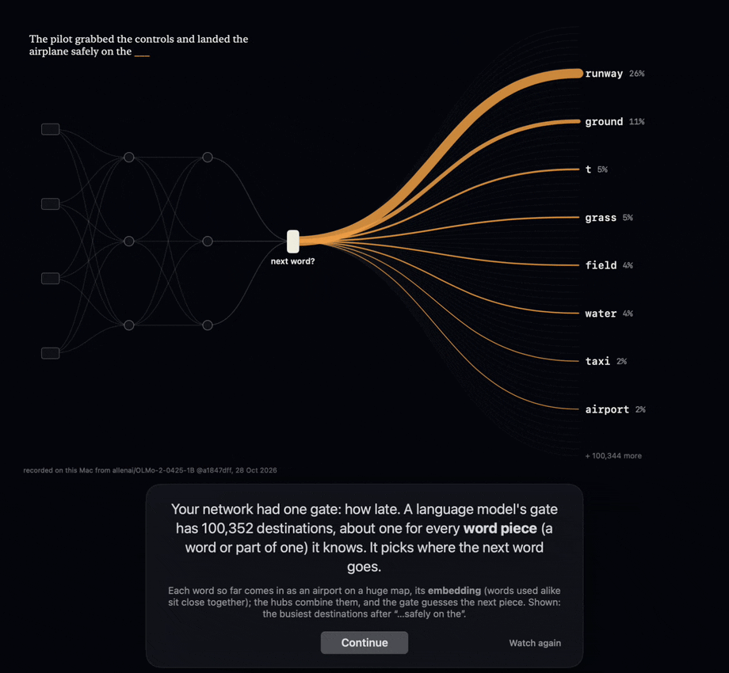
</p>

Then open the hood. The app shows all 16 × 8,192 neurons, the "desks" on each "floor" of the building, firing
word by word. Find an idea inside the model, erase it, and compare the answers:

<p align="center">
  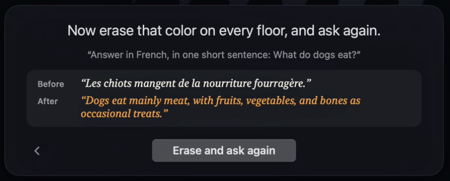
</p>

**Why OLMo?** It's *fully* open, not just open weights: the training data, the code and the checkpoints from every
stage are public. That's what lets Graduation show the same model after 0, 1 billion and 4 trillion word pieces of training,
and point at similar text in its actual training data.

## Install and run

You need a Mac with Apple silicon, macOS 15 or later, Xcode, and a [Rust](https://rustup.rs) toolchain.

```sh
git clone https://github.com/dmnurieli/neuroscopeai.git
cd neuroscopeai
scripts/build.sh --run
```

The airline course needs nothing else. The first time you open "Inside a real AI" or Graduation's live page, the
app downloads OLMo 2 1B Instruct (about 3 GB, a pinned revision) from Hugging Face into
`~/Library/Application Support/NeuroScope/models/`.

## How it's built

```
SwiftUI + Metal app (app/)          the lessons, the airline map, the 3D neuron field
   ├── AirlineKit (pure Swift)      the teaching network + seeded flight logbook, unit-tested
   └── C ABI  engine/include/neuroscope.h
         Rust engine (engine/)      OLMo 2 on candle/Metal: capture activations, edit them mid-pass
```

- **The airline network** is a small ReLU network with Huber loss, trained in pure Swift on a logbook of 120,000
  synthetic flights generated from a fixed seed, so every Mac sees the same flights. The delays come from
  combinations, which is exactly what hidden layers can learn and a straight line can't.
- **The OLMo 2 engine** is Rust on [candle](https://github.com/huggingface/candle) with Metal, checked against
  Hugging Face transformers (`engine/tests/reference_olmo.rs`).
- **Graduation's model outputs** are recordings made with the app's own engine from Ai2's published training stages
  (`scripts/stages/`), so the app ships text instead of nine model checkpoints.

Developer notes and the rules that keep the lessons honest: [docs/DEVELOPING.md](docs/DEVELOPING.md). The
lesson-by-lesson spec: [docs/airline-course.md](docs/airline-course.md).

## Upcoming additions

The airline course is the core, and where everyone starts. But NeuroScope AI isn't an airline app. It's meant to
become a free, open school for AI: taking everyday people from no algebra and not a single line of code to real
expertise in everything AI can do. It has two halves: a **web portal** to
learn anywhere (coming soon), and this **app**, where you build real, useful models of your own that run privately
on your machine.

From the train-your-own stage onward, the lessons branch out to new examples. Here is what's planned. Everything
marked open is waiting for someone to build it: pick one, open an issue to say you're on it, and we'll shape it
together.

<p align="center">
  
</p>

### Language models

- **Train your own** *(in progress)*. Train a ~50M-parameter model shaped like OLMo 2 on about a billion words of
  Wikipedia, watch it go from gibberish to words to sentences, then open your own model in the neuron viewer. First
  benchmark: about five hours per billion word pieces on a Mac Studio, with MLX.
- **Embeddings.** Take a huge pile of text, give every word a place on a map, and watch words used alike drift
  together as it trains. It's the first step of pretraining a language model, and the idea behind search and
  recommendations.
- **Post-training.** Everything done after pretraining to make a model behave a certain way: fine-tuning on examples
  (SFT, LoRA), preference tuning (DPO), and direction editing such as steering and **abliteration**, which finds
  one direction inside the model and removes it from the weights. Specialise an open-weight model for a field like
  cybersecurity, give it a house voice, or see how a refusal lives in a single direction, what changes when it's
  removed, and why that matters for safety.

### Vision: detection

- **Face recognition.** Build a model that recognises people from a webcam or a security camera feed, and see how it
  turns a face into a list of numbers it can compare. Consent is part of the lesson: you enroll only people who
  agreed, and everything runs on your own machine.
- **Object recognition.** Find and box everyday objects in a live camera frame, and see what each layer learned to
  look for.
- **Open-vocabulary detection.** Models that find anything you can describe in words ("a red backpack", "a dog on
  the couch") by joining an image network to a language network.

### Vision: sort and make

- **Classification.** Teach a model your own categories (photos, documents, support messages, recorded calls) and
  learn when to trust its answers.
- **Image generation.** How a picture is made from pure noise, one clean-up step at a time (diffusion), and how a
  sentence steers it.

### Speech

- **Speech recognition.** How a network turns sound, drawn as a picture called a spectrogram, into words.
- **Voice models.** Not just using or cloning a voice, but the network that makes one: from text to sound, and what
  makes a voice sound like a particular person (cloning only with that person's consent).

### Platform

- **Web portal** *(coming soon)*. The full course in a browser, with exercises and saved progress. The app stays
  the place to build your own private models.
- **AI tutor: bring your own key.** Paste an Anthropic, OpenAI or OpenRouter API key, and a tutor appears beside the
  lesson. The hard part isn't the API call, it's the teaching. The tutor must behave like the app: answer the
  question that was asked, in two or three sentences; one idea at a time; point at what's on screen right now; use
  the everyday word first and the real term once; ask one question back instead of offering a menu; never a wall of
  text. Most unguided chatbots ramble, and a learner who has to wade through paragraphs loses the thread. Wanted:
  provider adapters, the lesson context the tutor sees, and a set of real learner questions to test that answers
  stay short and on point. Keys should live in the macOS Keychain.
- **Windows and Linux.** The engine is Rust on candle, which already runs on Windows and Linux (with CUDA or on the
  CPU). What's Mac-only is the interface: SwiftUI and the Metal neuron field. A port means a cross-platform
  interface (Tauri, egui or a web UI, say), a portable renderer for the 3D field (wgpu), the engine switched to
  candle's CUDA or CPU backends, and installers people can just download. The airline network (`AirlineKit`) is
  small, pure, unit-tested Swift that's easy to carry over. We won't get to this ourselves soon; it's yours if you
  want it.
- **Learn from the best.** The projects below each do something better than we do. Link to them from the right
  lessons and borrow their best ideas.
- **Translations**, **more open models**, and **your own lesson**. If you can explain one idea better than we do,
  that's a lesson.

## Related projects

NeuroScope stands on the shoulders of some wonderful teaching tools. If you like this, you'll like these:

| Project | What it's great at |
|---|---|
| [TensorFlow Playground](https://playground.tensorflow.org) | The classic: tinker with a small network in your browser and watch the decision boundary form |
| [CNN Explainer](https://poloclub.github.io/cnn-explainer/) | How an image network sees, layer by layer |
| [Transformer Explainer](https://poloclub.github.io/transformer-explainer/) | A live GPT-2 in your browser, with every step of the transformer laid out |
| [LLM Visualization](https://bbycroft.net/llm) | A 3D walk through every multiplication inside a GPT |
| [Neuronpedia](https://www.neuronpedia.org) | An open platform for exploring the features inside real language models |
| [Teachable Machine](https://teachablemachine.withgoogle.com) | Train an image or sound model from your webcam or microphone, in minutes |
| [3Blue1Brown: Neural networks](https://www.3blue1brown.com/topics/neural-networks) | The visual intuition behind the math, in video |
| [micrograd](https://github.com/karpathy/micrograd) and [Zero to Hero](https://karpathy.ai/zero-to-hero.html) | Backpropagation from scratch in code, for when you're ready to write it yourself |
| [Distill](https://distill.pub) | Interactive research articles that set the bar for explaining machine learning |

## Contributing

Contributions are welcome, especially from people who teach.

- **A better explanation.** If a lesson page lost you, that's a bug. Open an issue with the page and what confused
  you.
- **Anything marked open in [Upcoming additions](#upcoming-additions)**, or a lesson of your own.
- **Engine work**: more open models, faster capture, new kinds of edits.

Read [docs/DEVELOPING.md](docs/DEVELOPING.md) first. One rule matters above the others: every number a lesson shows
is computed, never typed.

## Credits

- [OLMo 2](https://allenai.org/olmo) by Ai2 (Apache 2.0): the model, its training stages and its open data.
- [candle](https://github.com/huggingface/candle) and [tokenizers](https://github.com/huggingface/tokenizers) by
  Hugging Face.
- [infini-gram](https://infini-gram.io) for counting phrases in OLMo's training data.

## License

[Apache License 2.0](LICENSE). Model weights are downloaded from Hugging Face under their own license and are not
part of this repository.
